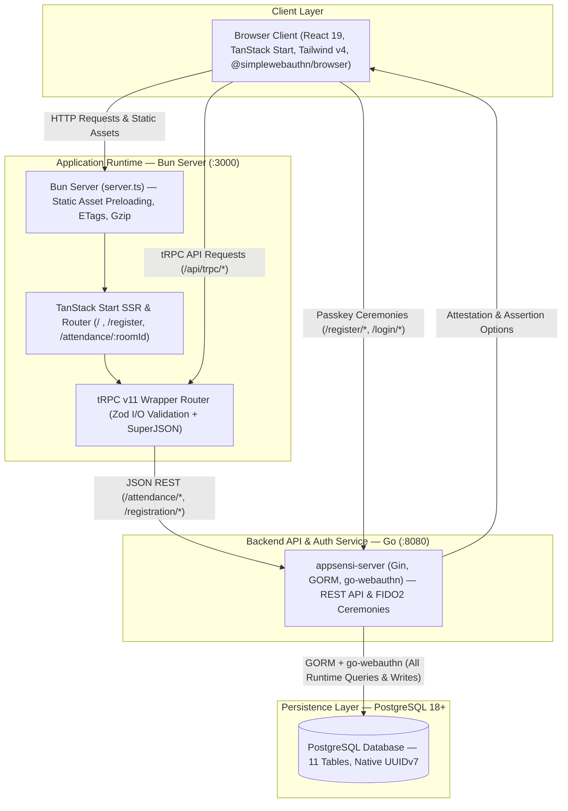

# System Architecture — Appsensi

Appsensi is an enterprise-grade campus classroom attendance system designed for sub-second biometric check-in, passwordless authentication via WebAuthn passkeys, and high-concurrency production serving.

---

## 1. High-Level Architecture



---

## 2. Component Layers

### 2.1 Frontend & SSR Layer (TanStack Start)
- **Framework**: [TanStack Start](https://tanstack.com/start) on Vite 8 & React 19.
- **Routing**: [TanStack Router](https://tanstack.com/router) with strict type safety:
  - `/` — Classroom and session picker with live schedule previews.
  - `/register` — Passkey registration portal with search and modal enrollment.
  - `/attendance/$roomId` — Live pending classroom roster, session switcher, and passkey verification.
- **Server State & Caching**: [TanStack Query v5](https://tanstack.com/query) with automatic 15-second background polling (`refetchInterval: 15_000`) and optimistic card exits.
- **Styling**: Tailwind CSS v4, Radix UI primitives, Lucide Icons, and Sonner notifications.

---

### 2.2 Production Runtime (`server.ts`)
The production server is built directly on native **Bun** (`bun run server.ts`), offering significant latency and throughput advantages over traditional Node.js runtimes.

```
Incoming Request
       │
       ▼
┌────────────────────────────────────────┐
│ Path starts with /assets/* or static?  │
└──────┬──────────────────────────┬──────┘
       │ YES                      │ NO
       ▼                          ▼
┌────────────────────────┐  ┌────────────────────────────────────┐
│ Check Preloaded Memory │  │ Forward to TanStack Start Handler  │
│  - ETag Match (304)?   │  │   (SSR, HTML rendering, tRPC API)  │
│  - Gzip Compressed?    │  └────────────────────────────────────┘
│  - Fallback: On-Demand │
└────────────────────────┘
```

#### Key Production Optimizations:
1. **Hybrid Asset Preloading**:
   - Small, high-frequency static assets (JS chunks, CSS stylesheets, SVGs, fonts) are pre-loaded into memory up to a configurable ceiling (`ASSET_PRELOAD_MAX_SIZE`, default 5 MB).
   - Large or rarely accessed files are served on-demand using streaming `Bun.file`.
2. **Built-in Compression & ETags**:
   - Assets are pre-compressed with Gzip at startup if exceeding `ASSET_PRELOAD_GZIP_MIN_SIZE` (1 KB).
   - Weak ETags (`W/"..."`) are computed and checked against `If-None-Match` for instant `304 Not Modified` responses.
3. **Cache Control**:
   - Immutable hashed bundles receive `Cache-Control: public, max-age=31536000, immutable`.
   - Dynamic pages and SSR payloads receive appropriate revalidation directives.

---

### 2.3 Backend REST & Authentication Layer (`appsensi-server`)
All runtime database queries, attendance mutations, and WebAuthn passkey ceremonies are handled by [`appsensi-server`](https://github.com/hapnan/appsensi-server) (`VITE_WEBAUTHN_SERVER_URL`, defaulting to `http://localhost:8080`) using Gin, GORM, and `go-webauthn`, while `appsensi`'s tRPC router wraps the REST JSON endpoints with Zod input/output schemas for end-to-end TypeScript safety:
- **REST Endpoints**: `/attendance/{demo-catalog,roster,check-in}` and `/registration/{list,link-student,cleanup-incomplete}`.
- **Protocol**: FIDO2 / WebAuthn Level 3 specification (`/register/{begin,finish}`, `/login/{begin,finish}`).
- **Key Pairs**: Asymmetric cryptography (ES256, RS256, Ed25519). Private keys remain isolated inside user device hardware (Apple Secure Enclave, Android StrongBox, Windows Hello TPM).
- **Challenge-Response**: Server-generated single-use cryptographic challenges prevent replay attacks.
- **Clone Detection**: The monotonic `sign_count` in the `credentials` table is checked on every assertion; any decrease flags a clone warning (`clone_warning = true`).

---

### 2.4 Database & Persistence Layer
PostgreSQL 18+ serves as the persistence store accessed at runtime by `appsensi-server` (via GORM) and managed for schema migrations/seeding by `appsensi`'s Drizzle CLI tooling (`db:push`, `db:migrate`, `db:seed`):

| Table | Role | Key Architectural Feature |
| :--- | :--- | :--- |
| `users` | WebAuthn Accounts | Uniquely indexed by email and username (student ID) |
| `webauthn_users` | RP Handles | Compound unique index on `(user_id, rp_id)` |
| `credentials` | Passkey Keys & Attestation | **Native `uuidv7()` PK** for sequential index clustering |
| `buildings` | Campus Buildings | Master facilities catalog (`A` through `I`) |
| `rooms` | Classrooms & Labs | Case-insensitive room codes (`h.2.4`) |
| `faculties` | Academic Faculties | Organizational department structure |
| `courses` | Course Catalog | Credit weights (SKS) and syllabi |
| `class_schedules` | Session Scheduling | Indexed by `(room_id, day_of_week, start_time)` |
| `students` | Student Profiles | Optional 1:1 linkage to `users` |
| `student_schedules` | Course Enrollment | Junction table for student-class mapping |
| `attendance` | Check-in Logs | Unique constraint on `(student_id, class_schedule_id, session_date)` |

---

## 3. Data Flow Pipelines

### 3.1 Classroom Check-In Flow
```
User (Browser)               appsensi (tRPC Wrapper)         appsensi-server (:8080)       PostgreSQL
      │                                │                                │                      │
      │ 1. POST /login/begin           │                                │                      │
      ├────────────────────────────────┼───────────────────────────────>│                      │
      │    { username }                │                                │                      │
      │<───────────────────────────────┼────────────────────────────────┤                      │
      │    Challenge & Options         │                                │                      │
      │                                │                                │                      │
      │ 2. Touch ID / Device Passkey   │                                │                      │
      │    (Cryptographic Signature)   │                                │                      │
      │                                │                                │                      │
      │ 3. POST /login/finish          │                                │                      │
      ├────────────────────────────────┼───────────────────────────────>│                      │
      │    { assertion, signature }    │                                │ Verify Signature     │
      │<───────────────────────────────┼────────────────────────────────┤ Update sign_count ──>│
      │    200 OK                      │                                │                      │
      │                                │                                │                      │
      │ 4. trpc.attendance.checkIn     │                                │                      │
      ├───────────────────────────────>│ POST /attendance/check-in      │                      │
      │    { room, studentId, ... }    ├───────────────────────────────>│ Validate Enrollment  │
      │                                │                                │ Check Idempotency    │
      │                                │                                │ INSERT attendance ──>│
      │                                │<───────────────────────────────┤                      │
      │<───────────────────────────────┤ Zod Output Parse + SuperJSON   │                      │
      │    CheckInResult (Date)        │                                │                      │
```

---

## 4. Security & Privacy Guarantees

1. **Zero Credential Exposure**:
   No passwords, hashes, PINs, or biometric templates are transmitted or stored in the database. Only public keys and attestation metadata are stored in PostgreSQL.
2. **Phishing Resistance**:
   Passkey assertions are cryptographically bound to the Relying Party ID (`rp_id`). A signature issued for an imposter domain will fail verification.
3. **Database Idempotency**:
   Unique composite constraint `(student_id, class_schedule_id, session_date)` prevents double-attendance even during rapid network retries or concurrent submissions.
4. **Isolated Hardware Security**:
   Private keys cannot be exported from authenticators, eliminating bulk database credential theft vulnerabilities.
