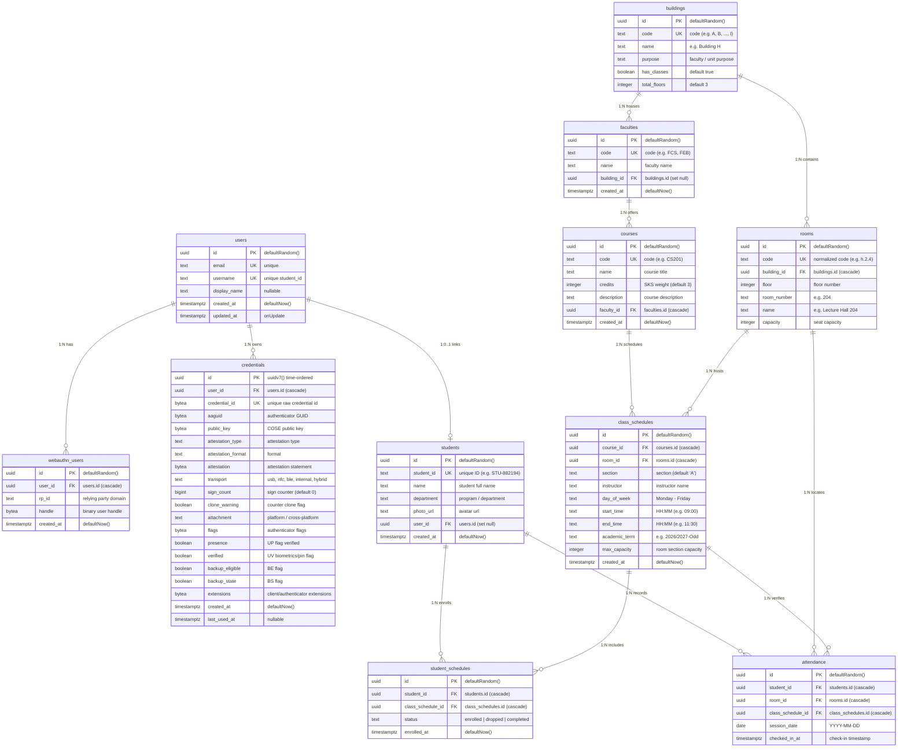

# Entity Relationship Diagram (ERD) — Appsensi

This document specifies the database structure, entity relationships, constraints, and data dictionary for **Appsensi** (`src/db/schema.ts` and `src/db/relations.ts`).

---

## 1. Visual Entity Relationship Diagram



---

## 2. Functional Domains

The schema is divided into 5 interconnected modules:

```
┌─────────────────────────────────┐        ┌─────────────────────────────────┐
│     Authentication & Passkey    │        │      Campus Infrastructure      │
│  users, webauthn_users,         │        │  buildings, rooms               │
│  credentials                    │        └────────────────┬────────────────┘
└───────────────┬─────────────────┘                         │
                │                                           │
                ▼                                           ▼
┌─────────────────────────────────┐        ┌─────────────────────────────────┐
│       Student Information       │        │       Curriculum & Schedule     │
│  students                       │        │  faculties, courses,            │
└───────────────┬─────────────────┘        │  class_schedules                │
                │                          └────────────────┬────────────────┘
                │          ┌────────────────────────────────┘
                ▼          ▼
┌────────────────────────────────────────────────────────────────────────────┐
│                         Enrollment & Attendance Logging                    │
│  student_schedules (Enrollment M:N)                                        │
│  attendance (Daily Check-in Verification)                                  │
└────────────────────────────────────────────────────────────────────────────┘
```

---

## 3. Data Dictionary

### 3.1 `users`
WebAuthn user accounts shared between the client application and companion auth server (`appsensi-server`).

| Column | Type | Nullable | Default | Constraints & Description |
| :--- | :--- | :---: | :---: | :--- |
| `id` | `uuid` | No | `gen_random_uuid()` | **PK** Unique user identifier |
| `email` | `text` | No | — | **UK** User email address |
| `username` | `text` | No | — | **UK** Matches `students.student_id` (e.g. `STU-FCS-001`) |
| `display_name` | `text` | Yes | `NULL` | Student full name or label |
| `created_at` | `timestamptz` | No | `now()` | Account registration timestamp |
| `updated_at` | `timestamptz` | Yes | `NULL` | Last profile update timestamp |

---

### 3.2 `webauthn_users`
WebAuthn Relying Party handles mapped to user accounts.

| Column | Type | Nullable | Default | Constraints & Description |
| :--- | :--- | :---: | :---: | :--- |
| `id` | `uuid` | No | `gen_random_uuid()` | **PK** Unique record ID |
| `user_id` | `uuid` | No | — | **FK** -> `users(id)` ON DELETE CASCADE |
| `rp_id` | `text` | No | — | Relying Party identifier (domain/host) |
| `handle` | `bytea` | No | — | Cryptographic user handle |
| `created_at` | `timestamptz` | No | `now()` | Record creation timestamp |

* **Indexes**:
  - `webauthn_users_user_rp_idx`: UNIQUE (`user_id`, `rp_id`)
  - `webauthn_users_handler_idx`: UNIQUE (`rp_id`, `handle`)

---

### 3.3 `credentials`
FIDO2 / WebAuthn public keys, authenticators, attestation metadata, and sign counters.

| Column | Type | Nullable | Default | Constraints & Description |
| :--- | :--- | :---: | :---: | :--- |
| `id` | `uuid` | No | `uuidv7()` | **PK** Time-ordered UUIDv7 for index locality |
| `user_id` | `uuid` | No | — | **FK** -> `users(id)` ON DELETE CASCADE |
| `credential_id`| `bytea` | No | — | **UK** Raw binary WebAuthn credential ID |
| `aaguid` | `bytea` | No | — | Authenticator Attestation GUID |
| `public_key` | `bytea` | No | — | COSE-encoded public key bytes |
| `attestation_type` | `text` | No | — | Type (e.g. `none`, `basic`, `self`) |
| `attestation_format` | `text` | No | — | Format (e.g. `packed`, `fido-u2f`) |
| `attestation` | `bytea` | Yes | `NULL` | Binary attestation statement |
| `transport` | `text` | No | — | Transports (e.g. `internal`, `hybrid`, `usb`) |
| `sign_count` | `bigint` | No | `0` | Monotonic counter to detect cloned authenticators |
| `clone_warning`| `boolean` | No | `false` | Triggered if counter decreases |
| `attachment` | `text` | No | — | Authenticator attachment (`platform` / `cross-platform`) |
| `flags` | `bytea` | Yes | `NULL` | Binary flags bitmap from authenticator data |
| `presence` | `boolean` | No | `false` | User Presence (UP) confirmed |
| `verified` | `boolean` | No | `false` | User Verification (UV) biometrics/PIN confirmed |
| `backup_eligible` | `boolean` | No | `false` | Backup Eligibility (BE) flag |
| `backup_state` | `boolean` | No | `false` | Backup State (BS) flag |
| `extensions` | `bytea` | Yes | `NULL` | Client / Authenticator extension outputs |
| `created_at` | `timestamptz` | No | `now()` | Key registration timestamp |
| `last_used_at` | `timestamptz` | Yes | `NULL` | Last check-in / authentication timestamp |

* **Indexes**:
  - `credentials_user_credential_idx`: UNIQUE (`user_id`, `credential_id`)
  - `credentials_user_idx`: INDEX (`user_id`)

---

### 3.4 `buildings`
Physical campus facilities (A through I).

| Column | Type | Nullable | Default | Constraints & Description |
| :--- | :--- | :---: | :---: | :--- |
| `id` | `uuid` | No | `gen_random_uuid()` | **PK** Unique building ID |
| `code` | `text` | No | — | **UK** Letter code (`A`, `B`, ..., `I`) |
| `name` | `text` | No | — | Name (e.g. `Building H`) |
| `purpose` | `text` | No | — | Faculty / department assignment |
| `has_classes` | `boolean` | No | `true` | Indicates if building has teaching rooms |
| `total_floors`| `integer` | No | `3` | Total number of building floors |

---

### 3.5 `rooms`
Classrooms, laboratories, and lecture halls.

| Column | Type | Nullable | Default | Constraints & Description |
| :--- | :--- | :---: | :---: | :--- |
| `id` | `uuid` | No | `gen_random_uuid()` | **PK** Unique room ID |
| `code` | `text` | No | — | **UK** Normalized lowercase code (e.g. `h.2.4`) |
| `building_id` | `uuid` | No | — | **FK** -> `buildings(id)` ON DELETE CASCADE |
| `floor` | `integer` | No | — | Floor number (e.g. `2`) |
| `room_number` | `text` | No | — | Room number string (e.g. `204`) |
| `name` | `text` | Yes | `NULL` | Optional label (e.g. `Lecture Hall 204`) |
| `capacity` | `integer` | Yes | `NULL` | Seating capacity |

* **Indexes**:
  - `rooms_building_idx`: INDEX (`building_id`)

---

### 3.6 `faculties`
Academic faculties and colleges.

| Column | Type | Nullable | Default | Constraints & Description |
| :--- | :--- | :---: | :---: | :--- |
| `id` | `uuid` | No | `gen_random_uuid()` | **PK** Unique faculty ID |
| `code` | `text` | No | — | **UK** Faculty abbreviation (e.g. `FCS`, `FEB`) |
| `name` | `text` | No | — | Full faculty name |
| `building_id` | `uuid` | Yes | `NULL` | **FK** -> `buildings(id)` ON DELETE SET NULL |
| `created_at` | `timestamptz` | No | `now()` | Timestamp |

* **Indexes**:
  - `faculties_building_idx`: INDEX (`building_id`)

---

### 3.7 `courses`
Academic courses offered across faculties.

| Column | Type | Nullable | Default | Constraints & Description |
| :--- | :--- | :---: | :---: | :--- |
| `id` | `uuid` | No | `gen_random_uuid()` | **PK** Unique course ID |
| `code` | `text` | No | — | **UK** Course code (e.g. `CS201`) |
| `name` | `text` | No | — | Course title |
| `credits` | `integer` | No | `3` | Credit weight / SKS |
| `description` | `text` | Yes | `NULL` | Course syllabus summary |
| `faculty_id` | `uuid` | Yes | `NULL` | **FK** -> `faculties(id)` ON DELETE CASCADE |
| `created_at` | `timestamptz` | No | `now()` | Creation timestamp |

* **Indexes**:
  - `courses_faculty_idx`: INDEX (`faculty_id`)

---

### 3.8 `class_schedules`
Scheduled course meetings and time slots in specific rooms.

| Column | Type | Nullable | Default | Constraints & Description |
| :--- | :--- | :---: | :---: | :--- |
| `id` | `uuid` | No | `gen_random_uuid()` | **PK** Unique schedule slot ID |
| `course_id` | `uuid` | Yes | `NULL` | **FK** -> `courses(id)` ON DELETE CASCADE |
| `room_id` | `uuid` | Yes | `NULL` | **FK** -> `rooms(id)` ON DELETE CASCADE |
| `section` | `text` | Yes | `'A'` | Section code (`A`, `B`, `01`) |
| `instructor` | `text` | Yes | `NULL` | Lecturer / Professor name |
| `day_of_week` | `text` | Yes | `NULL` | Day name (`Monday`, `Tuesday`, ...) |
| `start_time` | `text` | Yes | `NULL` | Start time formatted `HH:MM` |
| `end_time` | `text` | Yes | `NULL` | End time formatted `HH:MM` |
| `academic_term`| `text` | Yes | `NULL` | Term identifier (e.g. `2026/2027-Odd`) |
| `max_capacity`| `integer` | Yes | `NULL` | Maximum enrolled students for section |
| `created_at` | `timestamptz` | No | `now()` | Creation timestamp |

* **Indexes**:
  - `class_schedules_course_sec_term_idx`: UNIQUE (`course_id`, `section`, `academic_term`)
  - `class_schedules_course_idx`: INDEX (`course_id`)
  - `class_schedules_room_idx`: INDEX (`room_id`)
  - `class_schedules_day_room_idx`: INDEX (`room_id`, `day_of_week`)

---

### 3.9 `students`
Student roster records eligible for attendance check-in.

| Column | Type | Nullable | Default | Constraints & Description |
| :--- | :--- | :---: | :---: | :--- |
| `id` | `uuid` | No | `gen_random_uuid()` | **PK** Unique student UUID |
| `student_id` | `text` | No | — | **UK** Student badge/NIM (e.g. `STU-882194`) |
| `name` | `text` | No | — | Full name |
| `department` | `text` | Yes | `NULL` | Study program / major |
| `photo_url` | `text` | Yes | `NULL` | Avatar profile image URL |
| `user_id` | `uuid` | Yes | `NULL` | **FK** -> `users(id)` ON DELETE SET NULL |
| `created_at` | `timestamptz` | No | `now()` | Creation timestamp |

* **Indexes**:
  - `students_user_idx`: INDEX (`user_id`)

---

### 3.10 `student_schedules`
Class section enrollment junction table (Many-to-Many between `students` and `class_schedules`).

| Column | Type | Nullable | Default | Constraints & Description |
| :--- | :--- | :---: | :---: | :--- |
| `id` | `uuid` | No | `gen_random_uuid()` | **PK** Unique enrollment ID |
| `student_id` | `uuid` | No | — | **FK** -> `students(id)` ON DELETE CASCADE |
| `class_schedule_id` | `uuid` | No | — | **FK** -> `class_schedules(id)` ON DELETE CASCADE |
| `status` | `text` | No | `'enrolled'` | Enrollment status (`enrolled`, `dropped`, `completed`) |
| `enrolled_at` | `timestamptz` | No | `now()` | Enrollment timestamp |

* **Indexes**:
  - `student_schedule_unique_idx`: UNIQUE (`student_id`, `class_schedule_id`)
  - `student_schedules_student_idx`: INDEX (`student_id`)
  - `student_schedules_class_idx`: INDEX (`class_schedule_id`)

---

### 3.11 `attendance`
Recorded classroom check-ins verified via student passkey.

| Column | Type | Nullable | Default | Constraints & Description |
| :--- | :--- | :---: | :---: | :--- |
| `id` | `uuid` | No | `gen_random_uuid()` | **PK** Unique check-in event ID |
| `student_id` | `uuid` | No | — | **FK** -> `students(id)` ON DELETE CASCADE |
| `room_id` | `uuid` | No | — | **FK** -> `rooms(id)` ON DELETE CASCADE |
| `class_schedule_id` | `uuid` | No | — | **FK** -> `class_schedules(id)` ON DELETE CASCADE |
| `session_date` | `date` | No | — | Session date formatted `YYYY-MM-DD` |
| `checked_in_at` | `timestamptz` | No | `now()` | Timestamp of passkey biometric verification |

* **Indexes**:
  - `attendance_student_room_day_idx`: UNIQUE (`student_id`, `class_schedule_id`, `session_date`)
  - `attendance_room_day_idx`: INDEX (`room_id`, `session_date`)
  - `attendance_class_schedule_idx`: INDEX (`class_schedule_id`)

---

## 4. Foreign Key Cardinality & Cascade Rules

| Source Table | Source Column | Target Table | Target Column | Cardinality | Delete Action |
| :--- | :--- | :--- | :--- | :---: | :--- |
| `webauthn_users` | `user_id` | `users` | `id` | N : 1 | `CASCADE` |
| `credentials` | `user_id` | `users` | `id` | N : 1 | `CASCADE` |
| `students` | `user_id` | `users` | `id` | 0..1 : 1 | `SET NULL` |
| `rooms` | `building_id` | `buildings` | `id` | N : 1 | `CASCADE` |
| `faculties` | `building_id` | `buildings` | `id` | N : 0..1 | `SET NULL` |
| `courses` | `faculty_id` | `faculties` | `id` | N : 1 | `CASCADE` |
| `class_schedules` | `course_id` | `courses` | `id` | N : 1 | `CASCADE` |
| `class_schedules` | `room_id` | `rooms` | `id` | N : 1 | `CASCADE` |
| `student_schedules`| `student_id` | `students` | `id` | N : 1 | `CASCADE` |
| `student_schedules`| `class_schedule_id` | `class_schedules` | `id` | N : 1 | `CASCADE` |
| `attendance` | `student_id` | `students` | `id` | N : 1 | `CASCADE` |
| `attendance` | `room_id` | `rooms` | `id` | N : 1 | `CASCADE` |
| `attendance` | `class_schedule_id` | `class_schedules` | `id` | N : 1 | `CASCADE` |

---

## 5. Architectural Notes

1. **UUIDv7 Primary Key on `credentials`**:
   `credentials.id` uses PostgreSQL 18's native `uuidv7()`. Unlike random `uuidv4`, UUIDv7 encodes a Unix millisecond timestamp in the high bits, preventing B-tree index fragmentation and maximizing insert performance as credentials scale.
2. **WebAuthn Verification Cycle**:
   When a student registers their passkey on `/register`, a user row is created in `users` and linked to `students.user_id`. During check-in on `/attendance/$roomId`, the companion Go backend verifies the assertion against `credentials`, and tRPC records the attendance entry in `attendance` with `(student_id, class_schedule_id, session_date)` uniqueness.
3. **Multi-Session Room Support**:
   A room can host multiple class sections in a day. `class_schedules` links courses to rooms with `(day_of_week, start_time, end_time)`. Attendance is scoped per `class_schedule_id` and `session_date`.
