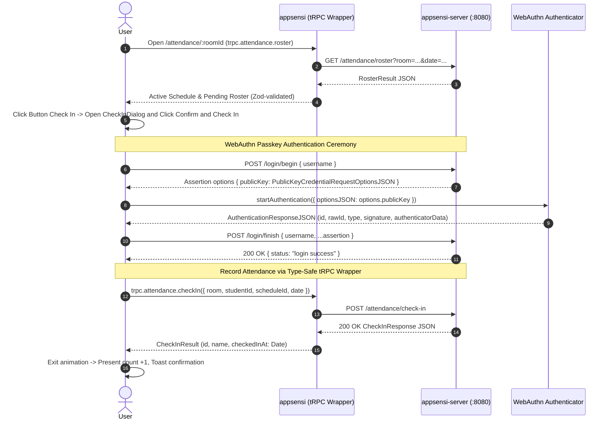

# Attendance Check-in Flow Diagram

This document illustrates the complete end-to-end flow for classroom attendance check-in via WebAuthn passkeys in **Appsensi**.

The companion SVG diagram is available at [`Flow_Diagram_Attendance.svg`](./Flow_Diagram_Attendance.svg).

---

## 1. Sequence Diagram

---

## 2. Actors & Responsibilities

| Actor | Label in Diagram | Description & Responsibilities |
| :--- | :--- | :--- |
| **Person** | `User (Person)` | TanStack Start + React 19 frontend (`/attendance/$roomId`). Manages UI state, modal dialogs, and triggers the WebAuthn ceremony. |
| **tRPC Wrapper** | `appsensi (tRPC Wrapper)` | Browser-local tRPC v11 + Zod + SuperJSON wrapper (`unstable_localLink`) forwarding attendance queries/mutations from the browser to `appsensi-server`. |
| **Backend & Auth Server** | `appsensi-server (:8080)` | Go + Gin + GORM + `go-webauthn` backend. Handles WebAuthn ceremonies (`/login/*`) and PostgreSQL attendance/roster endpoints (`/attendance/*`). |
| **Client Authenticator** | `WebAuthn Authenticator` | Hardware security key, Touch ID, Face ID, Windows Hello, or platform passkey provider running via `@simplewebauthn/browser`. |

---

## 3. Step-by-Step Ceremony Details

### Step 1: Load Room Roster
- **Request**: `GET /attendance/$roomId?date=YYYY-MM-DD` via `trpc.attendance.roster.queryOptions({ room, date, scheduleId })`.
- **Database Resolution**:
  1. Resolves room by normalized code (`rooms.code`).
  2. Queries class schedules for this room on the target day of week (`class_schedules` INNER JOIN `courses`).
  3. Automatically selects the active schedule based on current time or explicit switcher selection.
  4. Fetches enrolled students (`students` INNER JOIN `student_schedules`) and checks whether each has registered credentials (`credentials`).
  5. Computes `pending` students (enrolled minus already checked-in students on `sessionDate`).
- **Response**: Roster payload with active schedule, list of pending students, and present/total counters.

### Step 2: Open Check-In Dialog
- User locates the student in the pending roster (or uses `⌘K` / `Ctrl+K` instant search).
- Clicking the card opens [`CheckInDialog`](file:///c:/Users/gaming/Documents/GitHub/appsensi/src/components/attendance/check-in-dialog.tsx) in `confirm` phase.

### Step 3: Begin Passkey Verification
- **Endpoint**: `POST /login/begin` on `appsensi-server` (`http://localhost:8080`).
- **Body**: `{ username: student.username }` (where `username` corresponds to student ID, e.g. `STU-FCS-001`).
- **Response**: WebAuthn credential request options containing challenge, RP ID, allowed credentials, and user verification criteria.

### Step 4: Device Biometric / Security Key Assertion
- **Client Call**: `@simplewebauthn/browser`'s `startAuthentication({ optionsJSON })`.
- Device triggers native platform prompt (Touch ID, Windows Hello, Face ID, or PIN).
- Authenticator signs the challenge with the student's private key and increments the device sign counter.
- **Output**: `AuthenticationResponseJSON` containing `id`, `rawId`, `response.clientDataJSON`, `response.authenticatorData`, `response.signature`, and `response.userHandle`.

### Step 5: Finish Passkey Verification
- **Endpoint**: `POST /login/finish` on `appsensi-server`.
- **Body**: `{ username, ...assertion }`.
- **Backend Verification**:
  1. Validates signature against stored `credentials.public_key`.
  2. Verifies RP ID, origin, and challenge match the session.
  3. Checks sign counter to detect authenticator cloning (`credentials.sign_count`).
  4. Updates `credentials.last_used_at`.
- **Response**: `200 OK { status: "login success" }`.

### Step 6: Record Attendance
- **Mutation**: `trpc.attendance.checkIn` with `{ room, studentId, scheduleId, date }`.
- **Server Validations**:
  1. Room existence check.
  2. Student registered passkey verification.
  3. Active class schedule matching room & weekday.
  4. Student course enrollment verification (`student_schedules.status = 'enrolled'`).
  5. Idempotency guard: Verifies student has not already checked in for this class session and date.
- **Database Write**: Inserts row into [`attendance`](file:///c:/Users/gaming/Documents/GitHub/appsensi/src/db/schema.ts#L225) with `studentId`, `roomId`, `classScheduleId`, `sessionDate`, and `checkedInAt`.
- **Response**: `CheckInResult` with student info and ISO check-in timestamp.

### Step 7: UI Update & Toast
- Card triggers 300ms exit animation (`EXIT_ANIMATION_MS`).
- Present counter increments (`present + 1`), and student is removed from pending list.
- TanStack Query cache is updated optimistically and invalidated for background consistency.
- Success toast notification displays student name, room label, and timestamp.

---

## 4. Error Handling & Edge Cases

| Failure Scenario | Error Message / HTTP Status | Handled By |
| :--- | :--- | :--- |
| Browser lacks WebAuthn support | `"This browser does not support WebAuthn passkeys."` | [`usePasskeyCheckIn`](file:///c:/Users/gaming/Documents/GitHub/appsensi/src/hooks/use-passkey-check-in.ts) guard |
| Student has not registered passkey | `412 PRECONDITION_FAILED` (`"Student has not registered a passkey yet"`) | [`trpc.attendance.checkIn`](file:///c:/Users/gaming/Documents/GitHub/appsensi/src/integrations/trpc/router.ts) |
| User cancels device biometric prompt | `"Passkey verification was cancelled"` | [`describeCheckInError`](file:///c:/Users/gaming/Documents/GitHub/appsensi/src/hooks/use-passkey-check-in.ts) |
| Invalid biometric or mismatched key | `400 BAD_REQUEST` from `appsensi-server` | Catch block in [`attendance.$roomId.tsx`](file:///c:/Users/gaming/Documents/GitHub/appsensi/src/routes/attendance.$roomId.tsx) |
| Student not enrolled in class | `400 BAD_REQUEST` (`"Student is not enrolled in CS... in Room..."`) | `trpc.attendance.checkIn` validation |
| Already checked in today | `409 CONFLICT` (`"Student is already checked in"`) | `trpc.attendance.checkIn` unique constraint |
| No scheduled class in room today | `412 PRECONDITION_FAILED` (`"No class sessions are scheduled..."`) | `trpc.attendance.checkIn` validation |
