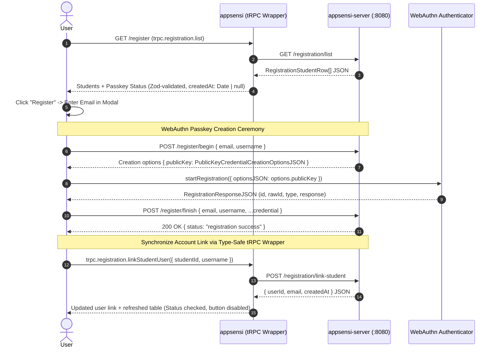

# Student Passkey Registration Flow Diagram

This document describes the student WebAuthn passkey registration ceremony in **Appsensi**.

The companion SVG sequence diagram is available at [`Flow_Diagram_Register.svg`](./Flow_Diagram_Register.svg).

---

## 1. Sequence Diagram

---

## 2. Actors & Responsibilities

| Actor | Label in Diagram | Description & Responsibilities |
| :--- | :--- | :--- |
| **Browser Client** | `User (Browser)` | TanStack Start frontend running on `/register`. Manages student selection, email modal, and coordinates registration with `@simplewebauthn/browser`. |
| **tRPC Wrapper** | `appsensi (tRPC Wrapper)` | Browser-local tRPC v11 + Zod + SuperJSON wrapper (`unstable_localLink`) forwarding registration queries/mutations from the browser to `appsensi-server`. |
| **Backend & Auth Server** | `appsensi-server (:8080)` | Go + Gin + GORM + `go-webauthn` backend. Handles passkey creation ceremonies (`/register/*`) and student registration REST endpoints (`/registration/*`). |
| **Authenticator** | `WebAuthn Authenticator` | Platform authenticator (Apple Touch ID / Face ID, Windows Hello, Android Biometrics) or FIDO2 hardware security key (YubiKey). |

---

## 3. Step-by-Step Ceremony Details

### Step 1: Query Student Registration Roster
- **Request**: `trpc.registration.list`
- **Database Query**: Performs a `LEFT JOIN` between `students`, `users`, and `credentials`.
- **Status Determination**: A student is marked `isRegistered: true` if they have both an associated `user_id` in `users` and at least one passkey in `credentials`.
- **Response**: List of all students with registration status, department, and timestamps.

### Step 2: Select Student & Modal Input
- The administrator or student clicks **Register Passkey** next to an unregistered student.
- A modal opens requesting the student's email address (used as the WebAuthn user entity display/account identifier).

### Step 3: Begin Registration Ceremony
- **Request**: `POST http://localhost:8080/register/begin`
- **Body**: `{ email: string, username: string }` where `username` matches `students.student_id` (e.g., `STU-FCS-001`).
- **Companion Server Action**:
  - Validates user parameters.
  - Inserts a pending user record into the PostgreSQL `users` table.
  - Generates cryptographic challenge and creation options (`PublicKeyCredentialCreationOptionsJSON`).
- **Response**: `creationOptions` containing challenge, Relying Party (`rp`) configuration, user entity, and supported public key algorithms (ES256, RS256, Ed25519).

### Step 4: Authenticator Credential Creation
- **Client Execution**: Invokes `startRegistration({ optionsJSON: options.publicKey })` via `@simplewebauthn/browser`.
- The device OS prompts for biometric verification (fingerprint, facial recognition, or device PIN).
- The authenticator generates an asymmetric key pair:
  - **Private Key**: Securely sealed inside the hardware security chip (Secure Enclave, TPM).
  - **Public Key**: Exported in COSE format.
- **Output**: `RegistrationResponseJSON` containing `id`, `rawId`, and attestation object (`clientDataJSON`, `attestationObject`).

### Step 5: Verify Attestation & Store Credential
- **Request**: `POST http://localhost:8080/register/finish`
- **Body**: `{ email, username, ...credential }`
- **Companion Server Verification**:
  1. Verifies client data JSON challenge and origin match.
  2. Parses and verifies the attestation statement.
  3. Inserts credential record into the PostgreSQL `credentials` table (`id` generated via native `uuidv7()`).
  4. Stores public key bytes, credential ID, AAGUID, and initial sign counter (`0`).
- **Response**: `200 OK { status: "registration success" }`.

### Step 6: Link Student Record
- **Mutation**: `trpc.registration.linkStudentUser({ studentId, username })`
- **Database Update**: Sets `students.user_id = users.id` for the corresponding student record.
- **Client Reactive Update**:
  - TanStack Query cache updates immediately.
  - The student's row displays a green "Registered" badge and the register button is disabled.
  - Toast displays confirmation of successful passkey registration.

---

## 4. Cancellation & Error Recovery

If the user dismisses the device biometric prompt or an error occurs during the ceremony:
1. The client intercepts the error in [`usePasskeyRegistration`](file:///c:/Users/gaming/Documents/GitHub/appsensi/src/hooks/use-passkey-registration.ts).
2. The client automatically calls `trpc.registration.cleanupIncompleteUser({ username })`.
3. This procedure safely deletes any dangling `users` record that lacks stored passkey credentials, ensuring the database remains clean and preventing account collision on future retry attempts.
