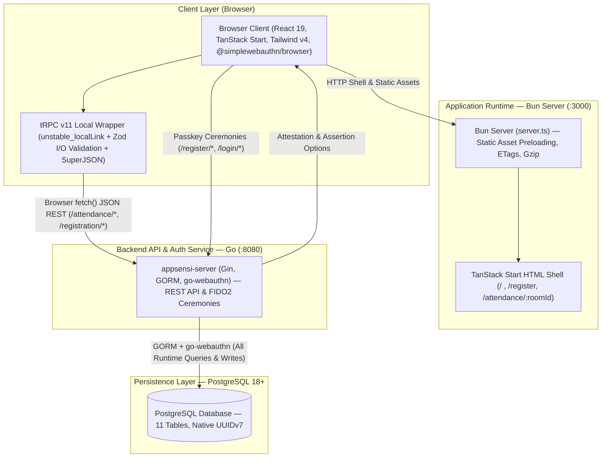

# Appsensi — Documentation Hub

Welcome to the comprehensive technical documentation for **Appsensi**, a campus classroom attendance web application powered by WebAuthn passkeys, real-time rosters, and scheduling.

---

## 📚 Documentation Index

| Document | Type | Description |
| :--- | :---: | :--- |
| [**Architecture Guide**](./ARCHITECTURE.md) | Guide | Full system architecture, runtime performance in Bun (`server.ts`), security guarantees, and component layers. |
| [**Entity Relationship Diagram (ERD)**](./ERD.md) | Schema / ERD | Database schema specification, complete data dictionary, indexes, and cascade rules across all 11 tables. |
| [**ERD Visual Diagram (SVG)**](./ERD.svg) | Diagram | Standalone dark-mode vector ER diagram with color-coded domains and key badges. |
| [**Attendance Flow Diagram**](./Flow_Diagram_Attendance.md) | Ceremony | Complete sequence walkthrough of the passkey verification and attendance check-in ceremony. |
| [**Attendance Flow Diagram (SVG)**](./Flow_Diagram_Attendance.svg) | Diagram | Standalone sequence diagram vector asset for the attendance check-in ceremony. |
| [**Registration Flow Diagram**](./Flow_Diagram_Register.md) | Ceremony | Complete sequence walkthrough of student onboarding and WebAuthn credential creation. |
| [**Registration Flow Diagram (SVG)**](./Flow_Diagram_Register.svg) | Diagram | Standalone sequence diagram vector asset for the student registration ceremony. |
| [**API Reference & Contracts**](./API.md) | Reference | Comprehensive contract documentation for all tRPC procedures and companion Go WebAuthn endpoints. |

---

## 🏗️ System Overview

Appsensi uses a layered architecture where `appsensi` serves the React 19 + TanStack Start UI and wraps [`appsensi-server`](https://github.com/hapnan/appsensi-server) JSON REST endpoints with tRPC + Zod for end-to-end type safety:

---

## 🚀 Quick Navigation

- **Need to inspect database models?** See [`docs/ERD.md`](./ERD.md) or [`src/db/schema.ts`](../src/db/schema.ts).
- **Need to check WebAuthn payloads?** See [`docs/API.md`](./API.md).
- **Need to follow the check-in ceremony?** See [`docs/Flow_Diagram_Attendance.md`](./Flow_Diagram_Attendance.md).
- **Need to follow the registration ceremony?** See [`docs/Flow_Diagram_Register.md`](./Flow_Diagram_Register.md).
- **Need to tune production server caching?** See [`docs/ARCHITECTURE.md`](./ARCHITECTURE.md) and [`server.ts`](../server.ts).
